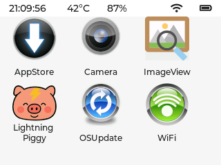
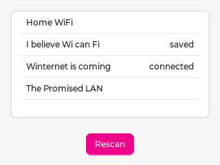
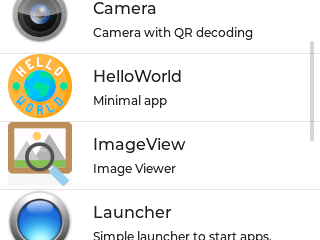
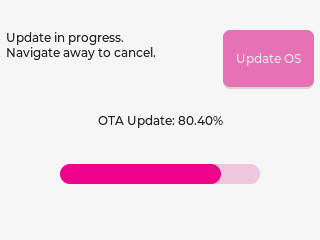

# Built-in Apps

MicroPythonOS includes essential apps to bootstrap the system. The launcher and the system apps live in [`/builtin/apps/`](https://github.com/MicroPythonOS/MicroPythonOS/tree/main/internal_filesystem/builtin/apps); the Media Player is preinstalled into `/apps/` instead, so it can be updated through the App Store like any other app.

- **Launcher**: Starts apps and provides the home screen.
- **WiFi**: Configures WiFi connections.
- **AppStore**: Downloads and installs new apps.
- **OSUpdate**: Manages Over-The-Air (OTA) system updates.
- **Settings**: Configuration for MicroPythonOS.
- **File Manager**: Browses the filesystem and opens files with the appropriate viewer.
- **Media Player**: Plays MJPEG video (AVI with the sound inside, or raw `.mjpeg` plus a WAV sidecar) and WAV/MP3 audio or RTTTL ringtones from the SD card. See [Media Player](media-player.md).

## Screenshots

  <figure>
    
    <figcaption>Launcher</figcaption>
  </figure>
  <figure>
    
    <figcaption>WiFi</figcaption>
  </figure>
  <figure>
    
    <figcaption>App Store</figcaption>
  </figure>
  <figure>
    
    <figcaption>OSUpdate</figcaption>
  </figure>

See [App Store](appstore.md) for additional apps.
